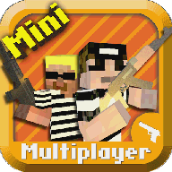

  

<h1 align="center">Project V7</h1>

<h3 align="center">Old games. New devices.</h3>

  Run legacy <strong>32-bit Android apps and games</strong> on modern <strong>64-bit-only Android devices</strong>. 
  Standalone APKs. No root required. No separate virtual machine.

  <code>Android</code> &nbsp; <code>ARM32 → ARM64</code> &nbsp; <code>GPL-3.0</code> &nbsp; <code>Open source</code>

  <a href="https://github.com/Jacqueb-1337/project-v7/releases/latest"><strong>⬇ Download latest release</strong></a>
  &nbsp; · &nbsp;
  <a href="#support-development"><strong>♥ Support development</strong></a>

  <a href="#supported-games">Supported games</a> ·
  <a href="#getting-started">Getting started</a> ·
  <a href="https://github.com/Jacqueb-1337/project-v7/issues">Roadmap &amp; issues</a> ·
  <a href="#contributing">Contributing</a>

---

## Bring your childhood games back to life

Project V7 is an open-source Android APK patcher and compatibility framework for running older 32-bit Android apps and games on newer 64-bit-only devices. It packages original ARM32 code within a standalone ARM64 Android host using a translation runtime and modular compatibility fixes.

## Supported games

| Game | Tested version | Engine | Status |
| :--- | :--- | :--- | :--- |
|  **Cops N Robbers** | 3.0.2 / 3.0.2-cnr1 | Unity 4.6.1f1 (Mono) | Gameplay verified |
|  **Regular Show: Best Park in the Universe** | 1.2.1 (version code 16) | Cocos2d-x | Gameplay verified |

Best Park requires the original matching APK and OBB. Its 1.2.0-labeled experimental profile is not independently gameplay-tested and accepts only a matching verified native library. Full campaign, legacy online services and device-wide compatibility have not been verified.

> [!NOTE]
> Project V7 is under active development. Only specifically tested game versions are confirmed playable. Other apps and games may require additional runtime work or compatibility modules; a catalog entry or experimental profile is not a guarantee of compatibility.

## Getting started

1. Download and install the [latest Project V7 Android Patcher](https://github.com/Jacqueb-1337/project-v7/releases/latest).
2. Choose a supported game and select its original APK (or an installed copy where supported).
3. Select the recommended compatibility modules and patch the APK.
4. Install the resulting standalone APK. Supply any required original OBB through [PV7 Game Storage](docs/guest-storage.md).

Have a game you want to revive? [Open a compatibility request](https://github.com/Jacqueb-1337/project-v7/issues) with its exact version, package name and engine if known.

## About Project V7

It started with one very specific problem: Cops N Robbers 3.0.2 is a 32-bit ARMv7 Unity game, and modern 64-bit-only phones cannot run it normally. Project V7 grew out of the work to make that game usable again without turning the whole phone into an old Android environment.

The long-term goal is to make the same approach reusable for other older Android apps and games.

## Android 32-bit compatibility

Project V7 is designed for cases such as:

- running 32-bit Android apps on 64-bit-only Android phones and tablets
- running older ARMv7 / armeabi-v7a Android apps when the device no longer provides native 32-bit app support
- preserving older 32-bit Unity Android games
- applying app-specific compatibility fixes without hard-coding every supported game into the patcher

Project V7 is not a full Android emulator or virtual machine. For apps that need it, Project V7 builds a 64-bit host around the original 32-bit app and applies compatibility modules for the app, its engine, and the Android behavior it expects.

## Current status

Project V7 currently has gameplay-tested profiles for Cops N Robbers 3.0.2 and Regular Show: Best Park in the Universe 1.2.1. Its legacy Unity baseline is Unity 4.6 Mono, alongside a separate Cocos2d-x native compatibility backend. Other Unity 4.x games are plausible candidates but remain unverified unless specifically listed as tested. Substantial native compatibility, engine-specific, and game-specific runtime work remains.

The supported-app list is loaded from this repository. It is not hard-coded into the Patcher APK. That means support for another app can be added through the catalog without requiring everyone to install a new version of the patcher.

## Download

Download the current Project V7 Android Patcher from the [Releases page](https://github.com/Jacqueb-1337/project-v7/releases/latest).

**Package identity:** Starting with v1.33.4, Project V7 uses `me.jacqueb.projectv7`, a separate Android application from Morphe Manager (`app.morphe.manager`). The earlier PV7 production v1.33.3 mistakenly reused Morphe's package name; do not use that release to update Morphe. Older PV7 debug builds (`app.morphe.manager.debug`) also install separately and cannot be automatically upgraded to production.

For supported apps, Project V7 can use:

- an APK you already have
- an installed copy of the app, where supported
- a source APK linked by that app's catalog entry

For Cops N Robbers, the "Help me find an APK" option points to the tested 3.0.2 source APK published in this repository's releases.

## How Project V7 runs 32-bit Android apps

Project V7 does more than change a manifest or rename an APK.

For apps that need it, the patcher builds a 64-bit host around the original 32-bit app and applies compatibility code for the app, its engine, and Android behavior it expects.

The exact work is controlled by compatibility modules and profiles in the catalog. A game can have its own fixes without those fixes being baked into the patcher itself.

A normal patch looks like this:

1. Open Project V7 and choose a supported app.
2. Choose the installed app or select an APK.
3. Project V7 detects the app and matches it with a tested compatibility profile when one is available.
4. The required compatibility modules are selected.
5. Project V7 builds the patched APK.
6. Install the result on the target device.

## Repository-defined app support

The catalog lives under `catalog/`.

Important parts are:

- `catalog/index.json` lists the apps, profiles, and modules available to Project V7.
- `catalog/apps/` contains the entries shown in Supported Apps, including names, download links, and icons.
- `catalog/profiles/` describes tested app versions and the compatibility modules they use.
- `catalog/modules/` contains reusable compatibility modules and app-specific fixes.

Adding a new supported app generally means adding its app entry, profile, and any modules it needs, then adding those files to the catalog index.

A catalog-only change does not require a new Patcher APK.

## Cops N Robbers 3.0.2 Android compatibility

Cops N Robbers 3.0.2 is currently the main test case for Project V7.

Package:

`com.joydo.minestrikenew`

Tested source versions:

- 3.0.2
- 3.0.2-cnr1

The Project V7 catalog currently recommends the common compatibility layer and the CNR-specific compatibility module for this version.

## Frequently asked questions

### Can Project V7 run 32-bit Android apps on 64-bit-only phones?

For supported apps, yes. Project V7 provides an app-specific compatibility path for running original 32-bit Android code on newer 64-bit-only Android devices.

### Does Project V7 support ARMv7 / armeabi-v7a Android apps?

ARMv7 / armeabi-v7a apps are a primary compatibility target, but support is app-specific. Project V7 does not automatically make every 32-bit APK compatible.

### Does Project V7 support Cops N Robbers 3.0.2?

Yes. Cops N Robbers 3.0.2 is the original and main Unity compatibility test case for Project V7. The catalog also includes a gameplay-tested Cocos2d-x profile for Regular Show: Best Park in the Universe 1.2.1. Other games remain a work in progress.

### Will other older Unity games work?

Project V7 targets the **Unity 4.x era**, with a tested **Unity 4.6 Mono** baseline. Other 32-bit Unity games from that period are plausible candidates, especially if their engine and APK layout are similar. They have **not** been validated, and may need additional native runtime work, API bridges, or game-specific patches. Do not assume a game works just because it was made with Unity 4.x.

### Why does "Morphe Patches" say it needs a newer patch engine?

Project V7 still supports optional third-party patch bundles from the upstream Morphe ecosystem. These are **separate** from Project V7's own compatibility catalog and its Cops N Robbers profile.

A bundle's `Patcher-Version` requirement describes the **underlying patch engine**, not the version of the Project V7 Android app. For example, a source requiring engine 2.0.0 cannot be used when the installed Project V7 build includes engine 1.15.0. This does **not** prove that a newer Project V7 release is available.

You can [check Project V7 releases](https://github.com/Jacqueb-1337/project-v7/releases) for a compatible engine or choose a different patch source. Installing Morphe Manager would **not** update Project V7. Project V7's own game compatibility modules live in the [catalog](catalog/README.md).

## Guest storage and OBB expansion files

Every PV7-generated wrapper exposes **PV7 Game Storage** in Android's Files
picker, with **obb**, **data**, **cache** and **files** all stored under
one app-private `GuestSharedStorage` directory. This does not grant access to other apps'
protected directories or make unsupported engines playable.

See [guest storage and OBB mapping](docs/guest-storage.md).

## Native compatibility backends

PV7's catalog can accept game entries for many Android APKs. The runtime currently has separate native compatibility paths for legacy ARM32 Unity 4.6 Mono and Cocos2d-x games. Cops N Robbers 3.0.2 and Regular Show: Best Park in the Universe 1.2.1 are gameplay-tested reference configurations for these backends. Other games may need substantial engine-specific or game-specific fixes. A Cocos2d-x game uses its own native compatibility backend, not the existing CNR Unity wrapper.

See [engine compatibility and diagnostics](docs/compatibility-backends.md).

## Releases and updates

Project V7 maintains separate [production and debug release channels](docs/releases.md).
Production APKs require a private PV7 signing identity; older debug builds cannot be
upgraded in place to a differently signed production app. The [release setup guide](docs/releases.md)
explains the signing secrets, safe publishing, and how to verify the APK.

## Contributing

See the [Project V7 contributor getting-started guide](CONTRIBUTING.md) for a step-by-step game profile, catalog rules, validation, and pull requests.

Pull requests for new app profiles, compatibility fixes, and improvements to the patcher are welcome.

If you are adding another app, keep app-specific behavior in that app's module when possible. Reusable fixes should go into a general module so another app can use them later.

Please include enough information to reproduce what you tested, including the app version, package name, CPU architecture, and Android version.

## Support development

### Help keep classic games alive

Project V7 is independently developed, free and open source. Optional contributions help fund continued development, compatibility research, testing on additional devices, and the preservation of legacy Android games.

Every contribution helps. Donations are entirely optional and Project V7 will remain free and open source. Donations do not buy exclusive features or guarantee support for a particular game.

**A donation link will be added here once the funding page is set up.** In the meantime, testing games, reporting compatibility issues, contributing fixes, and starring or sharing the project are also great ways to support development.

## Credits

Project V7 is a modified fork of [Morphe Manager](https://github.com/MorpheApp/morphe-manager).

Morphe provided much of the Android manager foundation this project started from, including the app UI, APK patching workflow, installer support, and project structure. Project V7 is a separate project with its own name, purpose, catalog, and compatibility work. It is not an official Morphe release and is not affiliated with or endorsed by the Morphe project.

Morphe itself is built on work from [ReVanced Manager](https://github.com/ReVanced/revanced-manager) and [Universal ReVanced Manager](https://github.com/Jman-Github/Universal-ReVanced-Manager). Those projects deserve credit for the work that made the manager this fork started from possible.

The original Morphe license and notice files are kept in this repository.

## License

Project V7 is distributed under the GNU General Public License v3.0. See [LICENSE](LICENSE) for the full license.

The additional Morphe conditions under GPLv3 Section 7 are preserved in [NOTICE](NOTICE). In particular, modified versions must be clearly identified as different from Morphe, and the Morphe name, logos, and trademarks cannot be used as Project V7 branding.

"Project V7" is the name of this fork. References to Morphe in this README are for attribution and license compliance.
